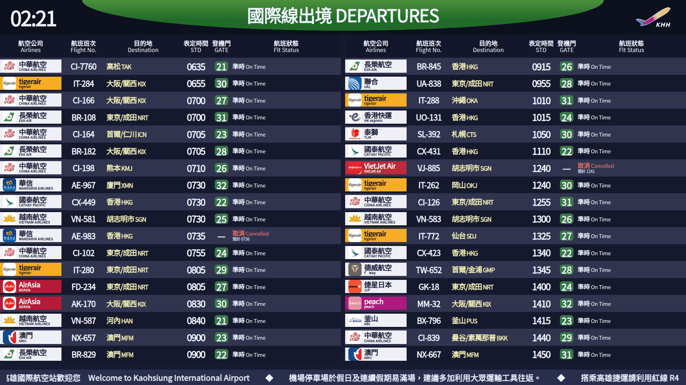

# KHH Flight Board

[](https://github.com/KageRyo/khh-flight-board/actions/workflows/check.yml)
[](https://github.com/KageRyo/khh-flight-board/actions/workflows/pages.yml)
[](LICENSE)

高雄國際機場航班資訊看板，提供國際出境、國際入境、國內離站與國內到站四種畫面。參考機場現場看板的配色與排版，適合開在電腦或大螢幕上輪播。

這是非官方專案，資料取自機場公開 JSON，定期更新；行程請以機場及航空公司公告為準。

[開啟線上看板](https://kageryo.github.io/khh-flight-board/)

[](docs/board-preview.gif)

## 使用

直接開啟線上看板即可，不需安裝。也可以連到指定畫面：

[國際出境](https://kageryo.github.io/khh-flight-board/#int) · [國際入境](https://kageryo.github.io/khh-flight-board/#int-arr) · [國內離站](https://kageryo.github.io/khh-flight-board/#dom) · [國內到站](https://kageryo.github.io/khh-flight-board/#dom-arr)

看板每 18 秒自動翻頁，可暫停、手動換頁、搜尋航班或篩選未完成航班。瀏覽器會記住看板、搜尋條件與輪播設定；指定連結的看板優先於上次設定。按「連結」可複製目前看板網址，有搜尋或篩選時可按「清除」還原全部航班。

開啟「四看板輪播」後，會看完目前看板的所有頁，再依序切換國際出境、國際入境、國內離站與國內到站。這個選項也會保留；預設只輪播目前看板。

鍵盤可用 `←`／`→` 翻頁、空白鍵暫停或繼續輪播、`1`–`4` 切換四種看板，全螢幕也適用。在搜尋欄輸入、操作選單或使用組合鍵時不會觸發快捷鍵。

全螢幕會隱藏操作列與頁尾，按 `Esc` 離開；資料過期或連線失敗的警示仍會顯示。國際線採雙欄，國內線採單欄，手機則改為單欄。頁碼只顯示於操作列，全螢幕不顯示。

底部跑馬燈會捲動顯示歡迎詞與[依官方旅客指南整理的提醒](docs/notices.md)；並非機場現場即時公告。跑馬燈動畫可獨立選擇「依系統／開啟動畫／關閉動畫」，並記住設定；關閉後可手動水平捲動閱讀。依系統模式會尊重減少動態效果偏好，仍可手動開啟。滑鼠停留或鍵盤聚焦時暫停文字捲動。

線上版透過 GitHub Actions 設定每 5 分鐘取得資料，頁面每 60 秒檢查新快照。**排程可能延遲，請看頁尾的實際取得時間。** 超過 15 分鐘會顯示快取警示；取得時間也不等於官方更新時間，官方資料未附航班日期。

## 其他位置的畫面

[登機門](https://kageryo.github.io/khh-flight-board/gate.html) · [報到櫃台](https://kageryo.github.io/khh-flight-board/counter.html)

可指定國際／國內離站、登機門或報到區、航空公司與航班，再進入全螢幕。選擇會保留在網址中，可直接分享；總覽頁尾也有切換入口。[畫面預覽與資料說明](docs/screens.md)。

## 本機執行

需要 [Node.js 22.19+](https://nodejs.org/)，不需安裝套件或 API 金鑰。

```sh
git clone https://github.com/KageRyo/khh-flight-board.git
cd khh-flight-board
npm start
```

開啟 <http://127.0.0.1:3000>，維持終端機開啟，`Ctrl+C` 停止。Windows 也可雙擊 `start-board.cmd`。

本機版預設每 60 秒向官方查詢，失敗時保留最後成功資料。需要改連接埠、開放區網或調整輪詢間隔，可參考[設定與資料說明](docs/data.md)。

## 開發

```sh
npm test
npm run check
npm run build:pages
npm run check:freshness
```

`build:pages` 會抓取四組官方資料，輸出至 `dist/`；設定 `PREVIOUS_SITE_URL` 可使用已發布快照備援。`check:freshness` 檢查線上四組資料是否有效、是否超過 15 分鐘；可用 `SITE_URL` 指定其他部署網址。

資料更新監測會在發布完成後及設定的每 15 分鐘排程執行，異常時讓 Actions 工作失敗。監測也受 GitHub 排程延遲影響，不保證即時告警。

[外觀參考](docs/appearance.md) · [資料、快取與部署方式](docs/data.md) · [驗證紀錄](docs/verification.md)

程式碼採用 [MIT License](LICENSE)；官方 Logo 與航班資料權利屬原權利人。
