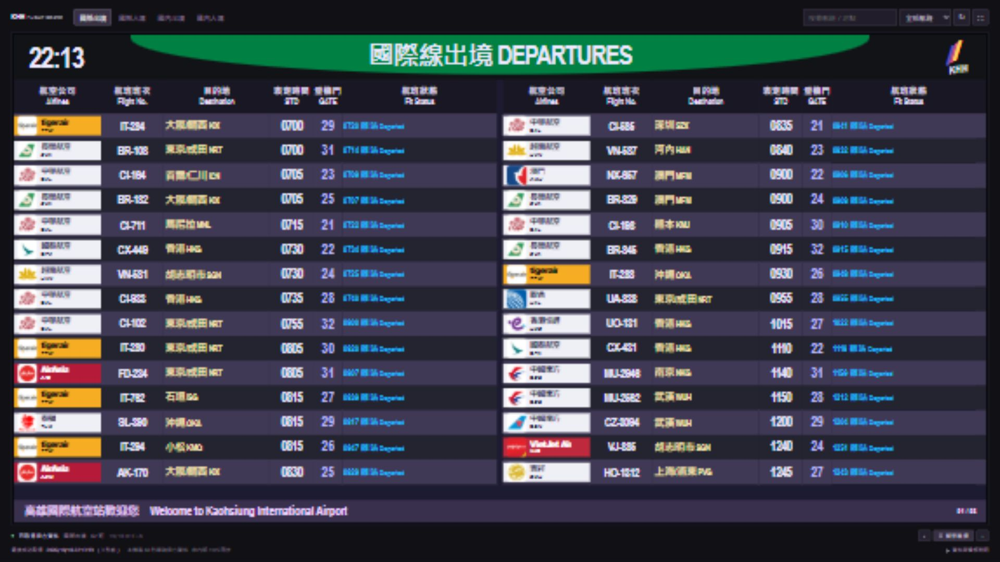
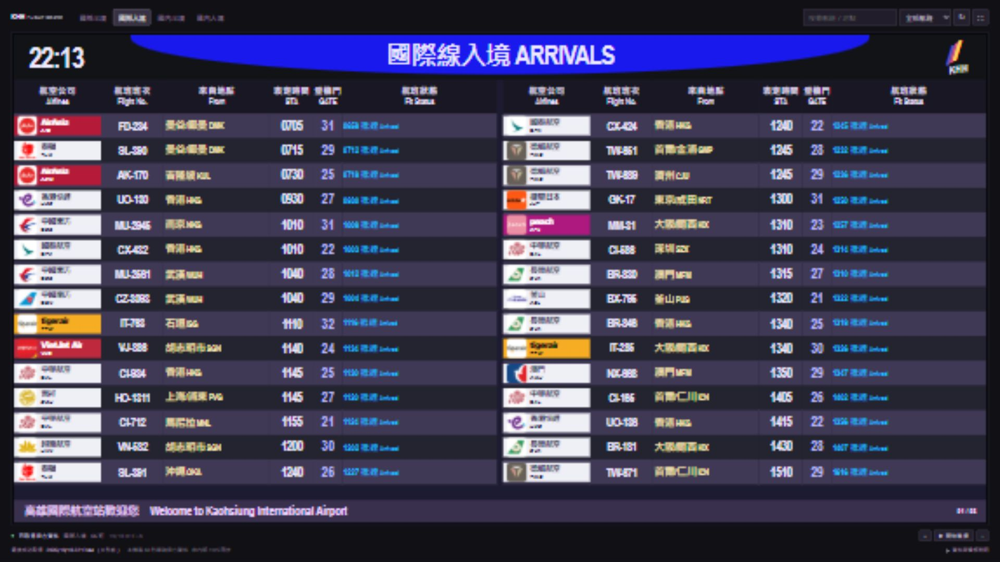
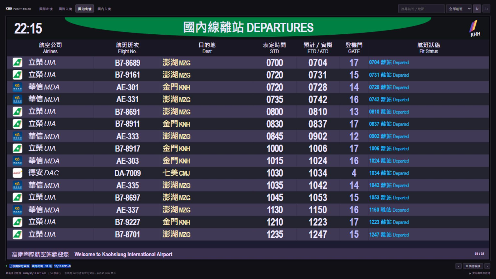

# KHH Flight Board

[開啟線上看板](https://kageryo.github.io/khh-flight-board/)

依高雄小港機場現場照片重製的航班資訊看板：深色背景、紫灰交錯航班列、航空公司識別、綠色出境／藍色入境弧形標頭、左右雙欄國際線與單欄大字國內線。提供 **國際出境、國際入境、國內離站、國內到站** 四種模式。





字型、Logo 排列與響應式細節為網頁適配，並非逐像素複製。使用官方公開 JSON，**不是機場內部 FIDS 的秒級同步畫面**。

## 線上版：GitHub Pages

直接開啟 [線上看板](https://kageryo.github.io/khh-flight-board/)，不需安裝。四種看板也有直接連結：

- [國際出境](https://kageryo.github.io/khh-flight-board/#int)
- [國際入境](https://kageryo.github.io/khh-flight-board/#int-arr)
- [國內離站](https://kageryo.github.io/khh-flight-board/#dom)
- [國內到站](https://kageryo.github.io/khh-flight-board/#dom-arr)

官方 JSON 目前沒有允許跨站讀取的 CORS 標頭，GitHub Pages 也無法執行 Node.js 代理。因此線上版由 GitHub Actions **約每 5 分鐘**抓取四組官方資料並發布靜態快照，頁面每 **60 秒**檢查網站上的新快照。排程與發布可能延遲；請以頁尾的實際取得時間判斷新鮮度，不是每 60 秒直接抓官方資料。

最後成功取得超過 **15 分鐘**時，線上版會顯示快取警示。官方故障時會嘗試保留上一次已發布的有效快照與原始成功時間；若任何資料源無法取得、且沒有有效舊快照，建置中止，現有網站繼續服務。可於 [Actions](https://github.com/KageRyo/khh-flight-board/actions/workflows/pages.yml) 手動執行 `Run workflow` 重試。

Pages 採用 GitHub Actions 發布；推送 `main`、手動執行與排程都會觸發。公開儲存庫長期無活動可能被 GitHub 停用排程；若停止更新，請檢查 Actions 是否仍啟用。

## 本機版：每 60 秒查詢官方資料

安裝 [Node.js 22.19+](https://nodejs.org/)，在終端機執行：

```sh
git clone https://github.com/KageRyo/khh-flight-board.git
cd khh-flight-board
npm start
```

開啟 [本機看板](http://127.0.0.1:3000)，維持終端機開啟，`Ctrl+C` 停止。Windows 可雙擊 `start-board.cmd`。不需要 API 金鑰、套件安裝或編譯。

本機版由同源 `/api/flights?source=int` 代理固定官方網址，解決 CORS。其他來源為 `int-arr`、`dom`、`dom-arr`。兩個並行請求不會重複抓取；更新按鈕也遵守設定間隔。未開啟看板時不會額外查詢官方資料。

## 顯示與操作

- 四組官方資料與瀏覽器／磁碟快取各自獨立，切換不混用資料。
- 航空公司名稱與圖示、航班編號、出發／目的地、表定時間、預計／實際時間、登機門及原始狀態。
- 國際線雙欄，國內線單欄，依實際可用高度決定每頁列數；縮窄螢幕時改為單欄。
- 預設每 18 秒自動翻頁；可暫停、手動翻頁、搜尋或篩選未完成航班。
- 全螢幕模式隱藏控制列、更新時間與說明列，呈現純看板；錯誤／快取警示仍顯示在看板內。按 `Esc` 離開。瀏覽器不支援時可用 `F11`。
- 入境、出境分別使用藍色、綠色弧形標頭；狀態使用白、綠、青藍、粉紅等辨識色。
- 取得失敗時保留最後成功資料，不把失敗時間當成成功更新時間。

## 設定

複製 `.env.example` 為 `.env`，修改後重新啟動：

```dotenv
HOST=127.0.0.1
PORT=3000
POLL_SECONDS=60
UPSTREAM_TIMEOUT_SECONDS=12
```

| 設定 | 預設 | 用途 |
| --- | --- | --- |
| `HOST` | `127.0.0.1` | 預設僅本機；區網展示可自行改為 `0.0.0.0` |
| `PORT` | `3000` | 1–65535，連接埠占用時改為 3001 等 |
| `POLL_SECONDS` | `60` | 本機查詢間隔，30–3600 秒 |
| `UPSTREAM_TIMEOUT_SECONDS` | `12` | 本機官方連線逾時，2–25 秒 |

`.env` 不影響 Pages 排程。Pages 的排程設定在 `.github/workflows/pages.yml`。MVP 沒有帳號或公開後端服務設計，預設只監聽本機。

## 官方資料與時間語意

| 看板 | 官方資料 | 地點欄位 |
| --- | --- | --- |
| 國際出境 | [INTDEP](https://www.kia.gov.tw/Announce/NewsArea/InstantSchedule_INTDEP.json) | `goalAirportName / goalAirportCode`，目的地 |
| 國際入境 | [INTARR](https://www.kia.gov.tw/Announce/NewsArea/InstantSchedule_INTARR.json) | `upAirportName / upAirportCode`，來自地點 |
| 國內離站 | [DOMDEP](https://www.kia.gov.tw/Announce/NewsArea/InstantSchedule_DOMDEP.json) | 目的地 |
| 國內到站 | [DOMARR](https://www.kia.gov.tw/Announce/NewsArea/InstantSchedule_DOMARR.json) | 來自地點 |

`expectTime` 是表定時間；`realTime` 是異動時間，狀態已離站／抵達時標為實際，其餘為預計。國際線異動時間顯示在狀態區，國內線另有預計／實際欄位。時間以 `HHmm` 呈現，缺值為 `—`。不因時間差自行判定延誤，未知狀態原樣顯示，共掛文字不任意合併或刪除。英文為已知狀態的介面翻譯；未提供的行李轉盤、領取狀態等資訊不捏造。

官方 JSON 未提供航班日期、時區與來源發布時間。畫面採台灣時間（Asia/Taipei）；頁首時鐘是目前時間，不能證明清單屬於當日。**最後成功取得是本機或 GitHub 抓取及驗證資料的時間，不是官方更新時間。** 重新取得相同資料也無法證明上游是否新鮮；跨日快取保留完整原始時間與資料年齡。行程請以機場及航空公司公告為準。

## 快取與錯誤

本機成功資料保存於 `.cache/<source>.json`，瀏覽器另以 `localStorage` 保存。HTTP 錯誤、無效 JSON 或任一航班必要欄位異常不會覆蓋舊資料；合法空陣列 `[]` 則會清除舊清單。磁碟或瀏覽器快取無法寫入時會提示。

本機超過兩個輪詢間隔、Pages 超過 15 分鐘未成功取得時標為快取。代理或網路中斷後，已開啟頁面仍可保留清單；沒有 Service Worker，本機代理停止後重新整理整頁需先重啟 `npm start`。Logo 直接來自官方網站，失敗時保留航空公司文字。清除 `.cache/` 與網站儲存空間可重置快取。

## 開發與驗證

```sh
npm test
npm run check
npm run build:pages
```

`build:pages` 會實際抓取四組官方資料，輸出到忽略版本控制的 `dist/`。如需舊資料備援，可設定 `PREVIOUS_SITE_URL` 為已發布網站的完整網址。將 `dist/` 以一般靜態 HTTP 伺服器提供，即可預覽 Pages 模式。

測試涵蓋資料語意、四個來源、未知狀態、缺值、空清單、錯誤快取、並行節流、磁碟復原、實際高度排版，以及 Pages 備援與子路徑資產。[驗證紀錄](docs/verification.md)。

程式碼依 [MIT License](LICENSE) 授權；官方 Logo 與航班資料權利屬原權利人。
