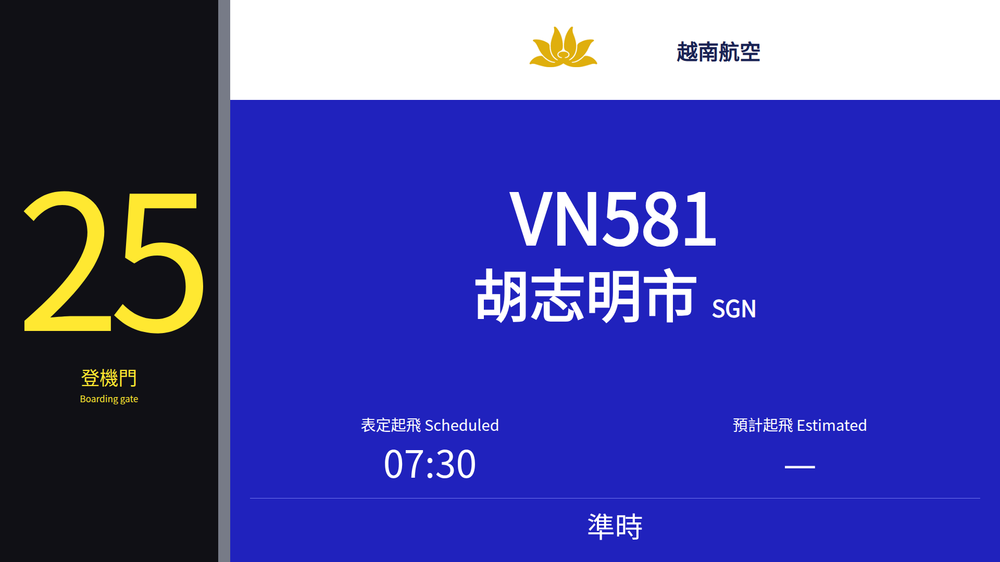
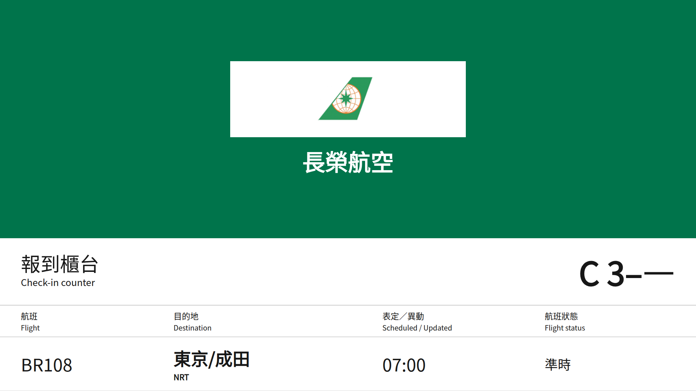

# 不同位置的螢幕

除航班總覽外，另有[登機門畫面](https://kageryo.github.io/khh-flight-board/gate.html)與[報到櫃台畫面](https://kageryo.github.io/khh-flight-board/counter.html)。兩者都可選國際／國內離站資料，再指定位置與航班；網址會保存選擇，複製網址即可分享。

登機門參考[高雄機場 25 號登機門的實拍](https://flight-report.com/en/report/16377/TransAsia-Airways-GE361-Kaohsiung-KHH-Taipa-MFM/)，使用獨立黃字門號牌、藍色航班區及白色航空公司識別區。

報到櫃台參考[高雄機場報到區的實拍](https://flight-report.com/en/report/51781/scoot-tz287-kaohsiung-khh-singapore-sin/)，以航空公司識別色為主，顯示一班選定航班。沒有資料依據的艙等、優先通道與行李限額不會加入。

畫面沿用官方公開資料，並非現場設備的即時映像；實拍年份、航空公司與設備版本也可能不同。官方櫃號中的 `0` 以未提供處理，例如 `C 3–0` 顯示為 `C 3–—`，`B 0–0` 只保留報到區 `B`，不推測末端櫃號。

指定的登機門、報到區或航空公司暫時沒有資料時，保留位置並顯示無航班，不會改成其他位置。網路失敗時保留成功資料與原始取得時間，過期或錯誤警示在全螢幕仍會顯示。總覽、登機門與報到櫃台的提示可點右側 × 關閉；同一提示不會因計時或重試重新出現。恢復正常後再次異常、提示內容改變或切換資料來源時，會重新提醒；重新載入頁面也會恢復提示。關閉提示仍會保留操作列的資料時間與快取狀態。
